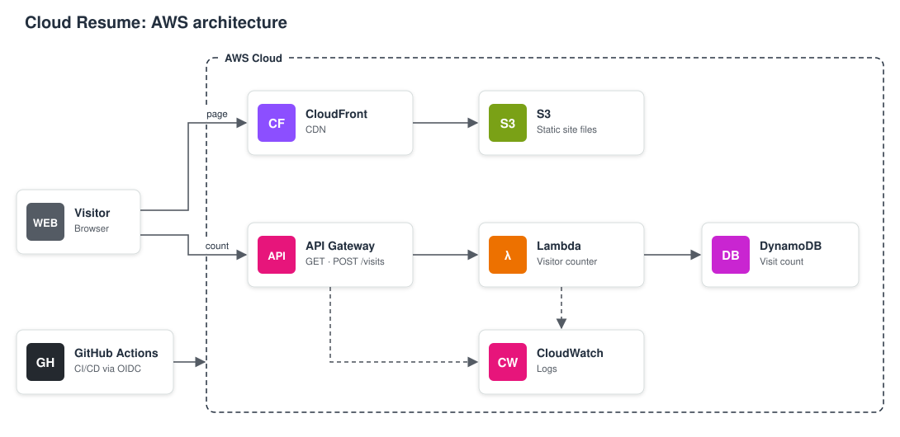

# Cloud Resume

- **Live CV:** https://d2bpagueb62obg.cloudfront.net
- **Challenge:** [Cloud Resume Challenge (AWS)](https://cloudresumechallenge.dev/docs/the-challenge/aws/)

## Layout

| Path | What |
| --- | --- |
| `frontend/` | HTML, CSS and `counter.js` |
| `backend/` | Visitor counter Lambda (Python) and its tests |
| `infra/` | Terraform for the site and API |
| `infra/ci-access/` | GitHub OIDC roles, applied locally only |
| `tests/` | Frontend checks and live smoke tests |
| `docs/` | Architecture diagram |

## To-do

- [ ] Move CSP from meta tag ro response headers (Check CloudFront plan)
- [ ] Add tflint and Trivy to CI
- [ ] Switch to custom domain
- [ ] Consider tradeofs of putting the API behind CloudFront
- [ ] Add a button to download the CV as PDF
- [ ] Change or expand the counter into something more complex
- [ ] Change the GitHub link to the project and add visualizations

## Sources

- [Terraform Registry](https://registry.terraform.io/)
- [Real-time visitor counter with DynamoDB, Lambda and GitHub Actions](https://businesscompassllc.com/creating-a-real-time-visitor-counter-with-dynamodb-lambda-and-github-actions-a-step-by-step-guide/)
- [Deploying API Gateway and Lambda with Terraform](https://dev.to/aws-builders/deploying-amazon-api-gateway-and-lambda-with-terraform-1i2o)
- [Create an API Gateway with Terraform](https://oneuptime.com/blog/post/2026-02-12-create-api-gateway-with-terraform/view)
- [AWS Cloud Resume Challenge: a step-by-step guide](https://medium.com/@chanukayasithcyw/aws-cloud-resume-challenge-a-step-by-step-guide-709ca19248dd)
- [AWS Cloud Resume Challenge: my attempt](https://dev.to/aws-builders/aws-cloud-resume-challenge-my-attempt-544m)
- [GitHub OIDC provider Terraform module](https://registry.terraform.io/modules/terraform-module/github-oidc-provider/aws/latest)
